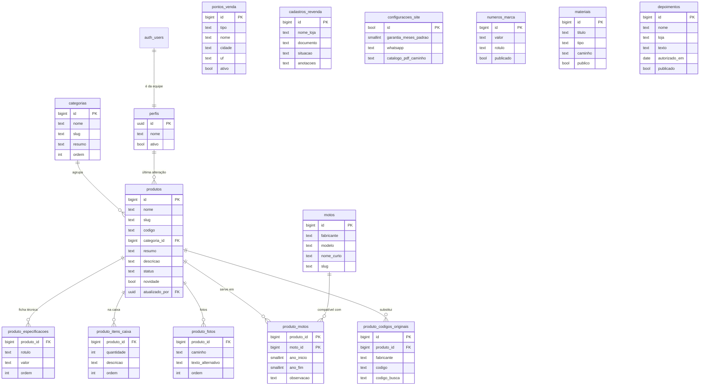

# Banco de dados MotoKoi

Banco em Postgres no Supabase. O site só **mostra** produtos: não tem preço, carrinho nem pedido de compra.

Arquivos:

- `supabase/migrations/20261113230836_esquema_inicial.sql`: tabelas, regras de acesso (RLS), gatilhos e a view de contagem.
- `supabase/migrations/20261113230852_storage_fotos.sql`: bucket `produtos` para as fotos.
- `supabase/migrations/20261113230906_resumo_produto_categoria.sql`: coluna `resumo` em produtos e categorias.
- `supabase/migrations/20261114175214_salvar_produto.sql`: função `salvar_produto`, que o painel usa para gravar um produto com ficha, itens da caixa e motos numa transação só.
- `supabase/migrations/20261115193429_concorrencia.sql`: o que veio da análise dos concorrentes (códigos originais, garantia, Inmetro, números da marca, materiais, depoimentos, busca do catálogo e bucket `materiais`).
- `supabase/migrations/20261115193447_salvar_produto_campos_novos.sql`: `salvar_produto` passa a gravar garantia, Inmetro e códigos originais.
- `supabase/seed.sql`: dados para desenvolvimento (categorias, motos, 9 produtos reais sem código nem foto, a loja da Mac Atacado).
- `supabase/testes/regras-de-acesso.mjs`: 64 testes que sobem um Postgres local e conferem quem pode ler e escrever o quê.

## Diagrama



`pontos_venda`, `cadastros_revenda`, `configuracoes_site`, `numeros_marca`, `materiais` e `depoimentos` não se ligam a nenhuma outra tabela.

## Tabelas

| Tabela | O que guarda | Tela que usa |
|---|---|---|
| `categorias` | Transmissão, Cabos, Carburadores... | Catálogo (filtro), Home (linhas) |
| `motos` | Modelos de moto. `modelo` é o nome completo (CG 150 Titan), `nome_curto` vai nos filtros (Titan 150) | Catálogo, Home (busca por moto), Produto |
| `produtos` | A peça: nome, código, categoria, resumo (linha curta do cartão), descrição, status, se aparece em Novidades | Todas do catálogo e do painel |
| `produto_especificacoes` | Ficha técnica em pares rótulo/valor, em ordem | Produto, Editar produto |
| `produto_itens_caixa` | O que vem na caixa, com quantidade | Produto |
| `produto_fotos` | Caminho da foto no Storage. A de menor `ordem` é a capa | Catálogo, Produto, Editar produto |
| `produto_motos` | Em quais motos a peça serve, com anos e observação | Produto ("Serve em"), filtro por moto |
| `pontos_venda` | Lojas próprias e revendedores, com endereço e posição no mapa | Onde comprar |
| `cadastros_revenda` | Formulário "Seja revendedor", com situação e anotações internas | Seja revendedor, Pedidos de revenda |
| `perfis` | Quem da equipe pode entrar no painel | Painel |
| `produto_codigos_originais` | Código da montadora que a peça substitui (Honda 16100-KVS-J01...). Vários por produto | Catálogo, Produto, busca, Editar produto |
| `configuracoes_site` | Uma linha só: garantia padrão, prazo de resposta, WhatsApp, PDF do catálogo | Garantia, Produto, Conteúdo do site |
| `numeros_marca` | Números da Home e de A marca, com publicado/rascunho | Home, A marca, Conteúdo do site |
| `materiais` | Arquivos para o lojista baixar (catálogo, fotos, fichas, logo) | Seja revendedor, Catálogo, Conteúdo do site |
| `depoimentos` | Depoimentos de revendedores, com data da autorização | Seja revendedor, Conteúdo do site |

Em `produtos` entraram também `garantia_meses` (vazio = usa o padrão), `inmetro_registro` e `ficha_tecnica_caminho`.

View `categorias_com_contagem`: categorias com o resumo e o total de produtos publicados, para a barra lateral do catálogo e a lista "A linha" da Home.

## Por que ficou assim

- **Moto em tabela própria, ligada ao produto por `produto_motos`.** Uma peça serve em várias motos e uma moto tem várias peças (muitos para muitos). A tabela do meio também guarda os anos e a observação, que mudam conforme o par peça e moto.
- **Ficha técnica e itens da caixa em tabelas, não em colunas.** Cada produto tem uma quantidade diferente de linhas.
- **Fotos no Storage, caminho no banco.** O banco guarda só o texto do caminho; o arquivo fica no bucket `produtos`.
- **`status` em vez de apagar.** O dono pode deixar uma peça como rascunho enquanto não tem foto ou código.
- **`resumo` é coluna, não tabela.** É a linha curta abaixo do nome ("43 × 16 · 428H · 118 elos"). Cada produto ou categoria tem no máximo um, então não precisa de tabela própria.
- **`codigo` pode ficar vazio**, mas não pode repetir. Muitos códigos ainda dependem do dono.
- **Situações e tipos como texto com `check`** (`'novo'`, `'em_contato'`...). Mudar uma lista depois é mais simples do que com `enum`.
- **`slug`** é o pedaço da URL (`/catalogo/kit-transmissao-titan-150`). Só aceita letras minúsculas, números e hífen.
- **Código original em tabela própria.** Uma peça pode substituir mais de um código (Honda e Yamaha, ou duas versões). A coluna `codigo_busca` é gerada pelo banco, só com letras e números, para "16100-KVS" e "16100kvs" acharem a mesma peça.
- **`configuracoes_site` com uma linha só.** A chave é `true` com `check (id)`, então não existe segunda linha. O painel só faz `update`.
- **Depoimento só publica com `autorizado_em`.** O `check` impede publicar sem registrar a autorização. Depoimento inventado em site de marca é propaganda enganosa.
- **`slug`** é o pedaço da URL (`/catalogo/kit-transmissao-titan-150`). Só aceita letras minúsculas, números e hífen.

## Quem pode fazer o quê

| | Visitante | Logado fora da equipe | Equipe (`perfis`) |
|---|---|---|---|
| Ler catálogo, motos, lojas | Só publicados e ativos | Só publicados e ativos | Tudo, inclusive rascunhos |
| Criar, editar e apagar no catálogo | Não | Não | Sim |
| Enviar cadastro de revenda | Sim, sempre como "novo" | Sim | Sim |
| Ler e mudar cadastros de revenda | Não | Não | Sim |
| Enviar fotos e arquivos (PDF, ZIP) | Não | Não | Sim |
| Ler números, depoimentos e materiais | Só publicados | Só publicados | Tudo |
| Mudar garantia padrão e WhatsApp | Não | Não | Sim |

Ser "da equipe" não é só fazer login: a pessoa precisa estar em `perfis` com `ativo = true`. A função `private.eh_admin()` faz essa checagem e fica num esquema que a API não expõe.

## Como aplicar

Com a CLI do Supabase, dentro da pasta do projeto:

```bash
supabase link --project-ref SEU_PROJECT_REF
supabase db push        # aplica as migrações no projeto
```

Para desenvolvimento local, `supabase start` sobe o banco e `supabase db reset` aplica migrações e seed.

Sem a CLI: cole os arquivos de `migrations/`, na ordem do nome, no SQL Editor do painel do Supabase. Rode o `seed.sql` só em desenvolvimento.

Confira os comandos na documentação atual da CLI antes de rodar.

## Criar o primeiro usuário do painel

1. No painel do Supabase, em Authentication, crie o usuário com e-mail e senha.
2. No SQL Editor:

```sql
insert into public.perfis (id, nome)
select id, 'Nome do dono' from auth.users where email = 'email-do-dono@exemplo.com';
```

3. Em Authentication, desative o cadastro público de usuários. Ninguém precisa criar conta pelo site; só a equipe entra.

Para tirar alguém do painel sem apagar a conta: `update public.perfis set ativo = false where ...`.

## Consultas que o site vai fazer

```sql
-- Novidades da Home
select * from produtos
where status = 'publicado' and novidade
order by atualizado_em desc
limit 4;

-- Catálogo filtrado por moto
select p.* from produtos p
join produto_motos pm on pm.produto_id = p.id
join motos m on m.id = pm.moto_id
where m.slug = 'honda-cg-150-titan';

-- Página do produto (com supabase-js, numa chamada só)
-- supabase.from('produtos')
--   .select('*, categorias(nome, slug), produto_especificacoes(*), produto_itens_caixa(*),
--            produto_fotos(*), produto_codigos_originais(fabricante, codigo),
--            produto_motos(ano_inicio, ano_fim, observacao, motos(*))')
--   .eq('slug', slug).single()

-- Busca do catálogo e da Home (texto, código MotoKoi, código original, moto, categoria, ano)
-- Hoje o site filtra em memória (src/lib/filtro.ts, mesma regra); esta função fica pronta para quando o catálogo crescer.
select * from buscar_produtos('16100-kvs', null, null, null);
select * from buscar_produtos(null, 'embreagem', 'honda-cg-150-titan', 2012);
-- supabase.rpc('buscar_produtos', { p_termo, p_categoria, p_moto, p_ano })
--   .select('*, categorias(nome, slug), produto_fotos(caminho, ordem)')

-- Garantia que aparece no produto
select coalesce(p.garantia_meses, c.garantia_meses_padrao) as meses
from produtos p cross join configuracoes_site c where p.slug = $1;
```

As regras de acesso já filtram os rascunhos para o visitante, mas deixe o `status = 'publicado'` explícito nas consultas do site: fica mais claro e usa o índice.

## Cuidados

- **Formulário de revenda:** grave com `insert` **sem** pedir o registro de volta (no supabase-js, não encadeie `.select()` depois do `.insert()`). O visitante pode inserir mas não pode ler, então pedir o retorno dá erro de permissão.
- **Spam no formulário:** ative o captcha do Supabase (hCaptcha ou Cloudflare Turnstile) ou valide o envio numa rota do servidor.
- **LGPD:** o formulário guarda nome, documento, WhatsApp e e-mail. A política de privacidade está em `/privacidade` (rascunho, o texto deve ser revisado por quem entende do assunto), e o painel de revenda tem "Excluir dados do cadastro" para atender pedidos de exclusão.
- **Arquivos para baixar** ficam no bucket `materiais` (PDF, ZIP, PNG, SVG, até 50 MB). O banco guarda só o caminho.
- **Dados de exemplo:** o banco do projeto tem dados de demonstração marcados com "(EX)". Para apagar, use `referencias/outros/arquivos-exemplo/apagar-exemplos.sql`.
- **Busca:** para algumas centenas de produtos, `ilike` em nome e código resolve. Se o catálogo crescer muito, dá para trocar por busca de texto completo.
- **Ordem das fotos:** ao reordenar, atualize a coluna `ordem` de todas as fotos do produto.
- **Se um dia o site vender:** entram tabelas novas (preço, estoque, clientes, pedidos, itens do pedido, pagamento). As tabelas atuais continuam valendo.

## Rodar os testes

```bash
npm install @electric-sql/pglite
node supabase/testes/regras-de-acesso.mjs
```

O teste usa um Postgres em memória e imita só o pedaço do Supabase de que o banco precisa (`auth.uid()`, papéis `anon` e `authenticated`, tabela do Storage). Ele confere as regras, não substitui testar no projeto real do Supabase.
